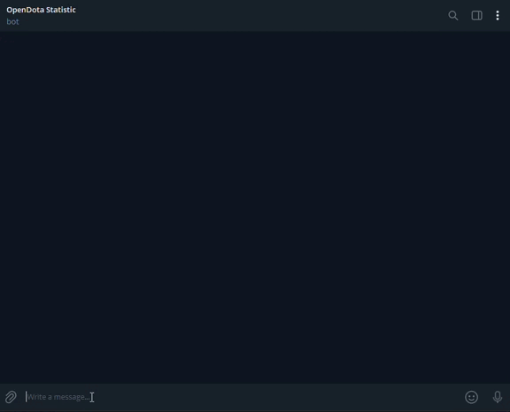

# Dota 2 Stats Bot
 
Telegram-бот, который показывает статистику игрока Dota 2: профиль (ник, MMR, ранг), любимых героев и последние матчи. Вкладки переключаются кнопками прямо в одном сообщении. Бот умеет запоминать несколько Steam-аккаунтов пользователя и подписывать их своими названиями.
 
Попробовать: https://t.me/OpenDotaStatistic_bot

Данные берутся из [OpenDota API](https://docs.opendota.com/).
 

 
## Возможности
 
- Принимает профиль в любом удобном формате:
  - ссылка на Dotabuff (`https://www.dotabuff.com/players/123456789`)
  - ссылка на Steam с числовым ID (`steamcommunity.com/profiles/7656119...`)
  - ссылка на Steam с кастомным именем (`steamcommunity.com/id/nickname`)
  - Steam32ID или Steam64ID цифрами
- Вкладки с переключением кнопками:
  - **Профиль**: ник, оценка MMR, ранг (медаль и звёзды)
  - **Сигнатурные герои**: топ-5 по количеству игр с винрейтом
  - **Последние матчи**: результат, герой, K/D/A, длительность
- Привязка нескольких Steam-аккаунтов с необязательным названием, быстрый доступ к ним через `/me` и отвязка через `/unlink`
- Защита от типичных ошибок: экранирование HTML, нетекстовые сообщения, недоступный API, лимит длины сообщения Telegram, устаревшие кнопки
## Технологии
 
- Python 3.10+
- [aiogram 3.7+](https://docs.aiogram.dev/) (FSM, роутеры, `CallbackData`, inline-клавиатуры)
- aiohttp (асинхронные HTTP-запросы)
- aiosqlite (SQLite)
- python-dotenv (конфигурация через `.env`)
- pytest (тесты)
- OpenDota API и Steam Web API
## Как это устроено
 
1. Пользователь отправляет `/stats`, и бот переходит в состояние ожидания ID (FSM).
2. Из присланного текста извлекается Steam32ID (при необходимости кастомное имя превращается в ID через Steam API).
3. Бот показывает профиль и inline-кнопки: «Профиль», «Сигнатурные герои», «Последние матчи».
4. Steam32ID хранится в `callback_data` кнопок (класс `CallbackData`). При нажатии бот запрашивает нужные данные у OpenDota и редактирует то же сообщение.
5. Команда `/link` сохраняет пару «Telegram ID и Steam ID» в SQLite через `aiosqlite`. После привязки бот предлагает ввести название аккаунта или пропустить этот шаг.
6. Команда `/me` показывает привязанные аккаунты кнопками (на кнопке название, а если его нет, то Steam ID). Нажатие открывает профиль с вкладками.
7. Команда `/unlink` показывает список аккаунтов для удаления. После нажатия запись удаляется, а список обновляется.

Одна общая `aiohttp.ClientSession` создаётся при старте и передаётся в хендлеры через `dp["session"]`.
 
## Запуск
 
### 1. Клонируйте репозиторий
 
```bash
git clone https://github.com/ProKartopka/opendota-telegram-bot.git
cd opendota-telegram-bot
```
 
### 2. Создайте виртуальное окружение и установите зависимости
 
```bash
python -m venv .venv
 
# Linux / macOS
source .venv/bin/activate
# Windows
.venv\Scripts\activate
 
pip install -r requirements.txt
```
 
### 3. Настройте переменные окружения
 
Скопируйте `.env.example` в `.env` и заполните значения:
 
```bash
# Linux / macOS
cp .env.example .env
# Windows
copy .env.example .env
```
 
| Переменная      | Откуда взять                                                           | Обязательна |
|-----------------|------------------------------------------------------------------------|-------------|
| `BOT_TOKEN`     | Создайте бота у [@BotFather](https://t.me/BotFather)                   | да          |
| `STEAM_API_KEY` | [steamcommunity.com/dev/apikey](https://steamcommunity.com/dev/apikey) | нет*        |
| `DB_FILE`       | Путь к файлу SQLite, по умолчанию `userdata.db` рядом с кодом          | нет         |
 
\* Без `STEAM_API_KEY` не будут работать только ссылки вида `steamcommunity.com/id/<имя>`.
 
### 4. Запустите бота
 
```bash
python main.py
```
 
Файл базы данных создаётся автоматически при первом запуске (по умолчанию `userdata.db`, путь можно изменить переменной `DB_FILE`) и в репозиторий не попадает.
 
## Деплой
 
Бот работает на long polling, поэтому домен, сертификат и открытые порты не нужны: достаточно машины, которая работает круглосуточно. Пример для [Railway](https://railway.com/):
 
1. Подключите репозиторий с GitHub и укажите команду запуска `python main.py`. Зависимости ставятся из `requirements.txt`.
2. На вкладке **Variables** сервиса добавьте `BOT_TOKEN` и `STEAM_API_KEY` (файл `.env` в репозиторий не добавляется).
3. Создайте постоянный том (**volume**) и подключите его к сервису, указав путь монтирования, например `/data`.
4. Добавьте переменную `DB_FILE` со значением `/data/userdata.db` (путь должен начинаться с пути монтирования тома). Без тома файловая система временная, и привязки аккаунтов пропадают при каждом перезапуске.
5. Перед запуском на сервере остановите локальную копию бота: два процесса с одним токеном вызывают `TelegramConflictError`.
Условия бесплатных тарифов у платформ меняются, поэтому сверяйтесь с актуальной документацией.
 
## Запуск тестов
 
Тесты покрывают чистую логику форматирования (ранг, герои, результат матча) и не требуют токена или доступа к сети.
 
```bash
pip install pytest
pytest
```
 
## Команды бота
 
| Команда   | Описание                                          |
|-----------|---------------------------------------------------|
| `/start`  | Приветствие и сброс состояния                     |
| `/stats`  | Статистика игрока по ссылке или ID                |
| `/link`   | Привязать Steam-аккаунт и при желании назвать его |
| `/me`     | Список привязанных аккаунтов                      |
| `/unlink` | Отвязать Steam-аккаунт                            |
 
## Структура проекта
 
```
.
├── main.py              # запуск бота
├── api.py               # запросы к OpenDota и Steam, разбор ID
├── config.py            # константы, логирование, переменные окружения
├── formatters.py        # форматирование рангов, героев и матчей
├── view.py              # тексты вкладок профиля
├── keyboards.py         # inline-клавиатуры и данные кнопок
├── handlers.py          # команды, состояния FSM, нажатия кнопок
├── db.py                # работа с SQLite
├── test_formatters.py   # тесты форматирования
├── requirements.txt     # зависимости
├── .env.example         # пример конфигурации
├── .gitignore
├── README.md
└── docs/
    └── demo.gif         # демонстрация работы
```
 
## Планы по развитию
 
- [x] Последние матчи игрока
- [x] Inline-кнопки вместо текстового ввода
- [x] Привязка аккаунта и хранение в SQLite
- [x] Команды `/me` и `/unlink`
- [x] Выбор названия для привязанного аккаунта
- [x] Тесты форматирования (`pytest`)
- [ ] Тесты разбора ID
- [ ] Кнопка «← К списку» в профиле
- [ ] Кэширование ответов OpenDota
- [x] Деплой на Railway
- [ ] Деплой в Docker
## Благодарности
 
Данные предоставлены [OpenDota](https://www.opendota.com/). Проект не связан с Valve.
 