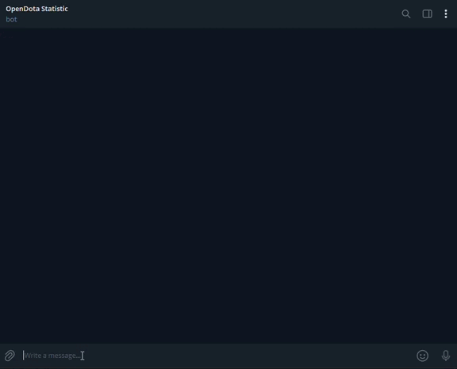

# Dota 2 Stats Bot

Telegram-бот, который показывает статистику игрока Dota 2:
ник, оценку MMR, ранг, самых часто используемых героев с винрейтом,
последние матчи игрока.

Данные берутся из [OpenDota API](https://docs.opendota.com/).




## Возможности

- Принимает профиль в любом удобном формате:
  - ссылка на Dotabuff (`https://www.dotabuff.com/players/123456789`)
  - ссылка на Steam с числовым ID (`steamcommunity.com/profiles/7656119...`)
  - ссылка на Steam с кастомным именем (`steamcommunity.com/id/nickname`)
  - Steam32ID или Steam64ID цифрами
- Показывает ник, оценку MMR и ранг (медаль и звёзды)
- Выводит топ-5 героев по количеству игр с винрейтом
- Выводит последние матчи (результат, герой, K/D/A, длительность)
- Привязка Steam аккаунта к боту
- Защищён от типичных ошибок: экранирование HTML, нетекстовые сообщения, недоступный API, лимит длины сообщения Telegram

## Технологии

- Python 3.10+
- aiogram 3.7+ (FSM, роутеры)
- aiosqlite (SQLite)
- aiohttp (асинхронные HTTP-запросы)
- python-dotenv (конфигурация через `.env`)
- OpenDota API и Steam Web API

## Как это устроено

1. Пользователь отправляет `/stats`, и бот переходит в состояние ожидания ID (FSM).
2. Из присланного текста извлекается Steam32ID (при необходимости кастомное имя превращается в ID через Steam API).
3. Бот показывает профиль и inline-кнопки: Профиль, Сигнатурные герои, Последние матчи.
4. Steam32ID хранится в `callback_data` кнопок (класс `CallbackData`). При нажатии бот запрашивает нужные данные у OpenDota и редактирует то же сообщение.
5. Команда `/link` сохраняет пару «Telegram ID и Steam ID» в SQLite через `aiosqlite`.

Одна общая `aiohttp.ClientSession` создаётся при старте и передаётся в хендлеры через `dp["session"]`.

## Запуск

### 1. Клонируйте репозиторий

```bash
git clone https://github.com/ProKartopka/opendota-telegram-bot.git
cd opendota-telegram-bot
```

### 2. Создайте виртуальное окружение и установите зависимости

```bash
python -m venv .venv

# Linux / macOS
source .venv/bin/activate
# Windows
.venv\Scripts\activate

pip install -r requirements.txt
```

### 3. Настройте переменные окружения

Скопируйте `.env.example` в `.env` и заполните значения:

```bash
cp .env.example .env
```

| Переменная      | Откуда взять                                                                 | Обязательна |
|-----------------|-------------------------------------------------------------------------------|-------------|
| `BOT_TOKEN`     | Создайте бота у [@BotFather](https://t.me/BotFather)                          | да          |
| `STEAM_API_KEY` | [steamcommunity.com/dev/apikey](https://steamcommunity.com/dev/apikey)        | нет*        |

\* Без `STEAM_API_KEY` не будут работать только ссылки вида `steamcommunity.com/id/<имя>`.

### 4. Запустите бота

```bash
python main.py
```

## Команды бота

| Команда  | Описание                                    |
|----------|---------------------------------------------|
| `/start` | Приветствие и сброс состояния               |
| `/stats` | Запросить статистику игрока по ссылке или ID |
| `/link` | Привязать Steam аккаунт к боту |
| `/me` | Список привязаныых аккаунтов |

## Структура проекта

```
.
├── main.py            # запуск бота
├── api.py             # работа с API
├── config.py          # константы, логирование, .env
├── formatters.py      # форматирование текста
├── handlers.py        # хендлеры
├── keyboards.py       # кнопки
├── view.py            # тексты вкладок профиля
├── db.py              # база данных
├── requirements.txt   # зависимости
├── .env.example       # пример конфигурации
├── .gitignore
├── README.md
└── docs/
    └── demo.gif        
```

## Планы по развитию

- [x] Последние матчи игрока
- [x] Inline-кнопки вместо текстового ввода
- [x] Привязка аккаунта и хранение в SQLite
- [ ] Кэширование ответов OpenDota
- [ ] Тесты (`pytest`) для парсинга ID и форматирования
- [ ] Деплой в Docker
- [x] Команда `/me` для удобного просмотра аккаунтов
- [ ] Выбор названия для привязанного аккаунта

## Благодарности

Данные предоставлены [OpenDota](https://www.opendota.com/). Проект не связан с Valve.